<picture>
  <source media="(prefers-color-scheme: dark)" srcset="docs/img/hero-dark.svg">
  
</picture>

# Cogby

Your context manager, as a plugin for Claude Code. Cogby keeps what you know and what you are
working on in a brain you own: a folder of markdown, kept as its own git repository, that Claude
searches before it answers and adds to as you work. Every fact in it has a source, and nothing is
silently rewritten.

You make the calls: Cogby brings the evidence, you decide. When something is being made for you,
it asks your view on what you chose to understand yourself, and handles the rest.

## Install

In Claude Code:

```
/plugin marketplace add yasser200104/cogby
/plugin install cogby@cogby
```

Then type `/cogby:onboarding` (or say "set up my brain"). Cogby says hello and how it works, then
two short steps in the chat: it asks to look through your work (calendar, email, files, past Claude
Code chats, only what you allow, lightly or deeply) and asks you up to four questions while it
looks; you check what it found on one screen, and it creates your brain. Then it shows you My view,
where you start. Safe defaults stand in for questions, and you never type a command.

Needs Node 22.13 or newer and git.

## Why a context system

<picture>
  <source media="(prefers-color-scheme: dark)" srcset="docs/img/twice-dark.svg">
  
</picture>

A model knows a great deal and nothing about your work. Which client, what was agreed, what you
ruled out last month: you carry that, and you type it again in every new chat. The answer is only
as good as what you remembered to say.

A context system moves that out of your head and into files. A session reads them before it
answers, and writes back what it learned, with the source. The tenth session on a project starts
where the ninth stopped, on any day, in any folder.

It is personal because nobody else's notes would do. The decisions and the names for things are
yours, and no model ships with them.

## What is in a brain

<picture>
  <source media="(prefers-color-scheme: dark)" srcset="docs/img/page-dark.svg">
  
</picture>

A brain is laid out as `projects/`, `areas/`, `resources/` and `archive/`. Every page has two
halves. Above the timeline mark is the current truth: a summary to act from and a table of facts,
each with its source. Below it is the evidence: dated lines, each naming where it came from and who
wrote it.

The rules a page is held to:

- **Evidence is added, never rewritten.** A fact that changes is marked superseded and stays. A
  wrong line is retracted and stays.
- **What an agent writes is marked.** It reads `unconfirmed` until you say it is right, so you can
  always tell Claude's notes from yours.
- **A decision says who made the call.** You alone, you taking Claude's suggestion, or you
  overriding it. A session on a project is shown its standing decisions, so it does not propose
  again what you ruled out.

## It goes where you work

<picture>
  <source media="(prefers-color-scheme: dark)" srcset="docs/img/travels-dark.svg">
  
</picture>

The plugin is installed once, for you, not per project. A session in any folder is told where the
brain is and what that folder is to it: the code of one project, a place for working files, or
nothing the brain should keep.

The brain carries its own rules (`AGENTS.md`), who you are and how to work for you
(`.cogby/self/`), and your routines. Push it to a private remote and it is the same brain on your
next computer.

Cogby is local-first and, today, for Claude Code only. The brain is a
folder on your machine and the plugin is a local program that reads and writes it, so it does not
install on claude.ai or Cowork. A Notion-backed option is being evaluated and is not in this
release.

A new brain has its own `.claude/settings.json`. In that folder it turns Claude's automatic memory
off (the brain is the memory), allows `git push` and denies a forced one, and enables Cogby beside
two of Anthropic's official security plugins. It is a file in your brain: change it as you like.

## What you get

**Memory.** A brain laid out as `projects/`, `areas/`, `resources/` and `archive/`. Each page has a
summary on top and dated, sourced evidence below. A project is one `card.md`: what it is, what is in
flight now and what is next on top, what was done and decided as dated lines below. A fact that changes is marked superseded, never
deleted. Any session, in any folder, starts by being told where the brain is and what waits on you.

**A private brain, beside your main one.** `cogby init --brain <folder> --private` makes a brain (or
marks one you have) private: it is used only from a chat or a command started in its own folder. It
is never the default brain, no other brain searches or imports it, and a chat opened in it uses no
other brain. This guards Cogby's own doors: it does not stop a person or an agent from reading its
files directly, and a chat opened in the wrong folder still saves to the brain of that folder.

**A decision log.** A decision is a dated line on the page it is about, with its reason, its
source and who made the call: you on your own, you taking Claude's suggestion, or you overriding it.
There is no separate decisions file. Only a choice that ruled out an alternative someone could bring
back counts; "let's do this first" does not, and nothing is saved as a decision on a guess: a
doubtful one is offered, unticked, when you wrap up. A decision can carry what you expect of it and
a date to look again. `cogby decisions` lists them across the brain, a session working on a project
is shown that project's standing decisions so it does not propose again what you ruled out, and the
weekly check-in counts how many calls were yours, accepted or overridden, and which are due a second
look. How one turned out is a new line that points at it; a reversed decision leaves the list and
stays in the record.

**Routines.** What you do on a rhythm with Claude (a morning check-in, a weekly review, a Friday
client update) is kept in your brain, one page per routine under `areas/routines/`: what it runs,
its rhythm, why it exists, where it is scheduled in Claude, and a dated line for every run with what
came of it. Claude's own scheduler does the running; Cogby builds none. The brain keeps the record,
so it is yours and travels with the brain, and a session starts by naming the routines that are due.
Cogby is the memory and the coach of your routines; whatever tool you use does the running. It
checks that scheduled routines still run and tells you when one did not, asks one question when a
schedule is gone ("Put it back" or "Leave it"), and shows on My view what each one's last run
found, flagging only a problem. Each routine's page says why it exists and, in plain words, where
it runs, and can hold its full instructions: say "I moved to another tool, set my routines up here"
and Cogby offers each one again from its page.

**Skills you use day to day.**

| Say | Skill | What happens |
|---|---|---|
| "remember that…", "remind me to…", "file this", "log this decision" | `capture` | Each item goes to its one home: a to-do, a note, a fact, a timeline line, a decision with who made the call |
| "prep me for my call with…" | `meeting-prep` | A one-page brief from what the brain knows and the last meeting records: where things stand, what was promised, what to ask |
| "debrief my 1:1 with…", "here are my notes from the meeting" | `meeting-notes` | Finds the transcript through your connectors (calendar and Drive, Granola, another notes tool), then decisions with who made the call, facts, commitments and your actions, shown once, then written; keeps a meeting record in `resources/meetings/` that links to the transcript |
| "digest this", "read this into my brain" | `digest` | One document or folder read once: its key points as sourced facts and dated lines, shown once, then written |
| "check in", "what needs me", "close the day", "weekly review", "review my decisions" | `check-in` | What is due, waiting or stale, in one screen; in the evening the day's decisions, weekly who made the calls and which are due a second look |
| "set up my routines", "add a routine", "pause the weekly review" | `routines` | The routine recorded in your brain, an offer to schedule it with the scheduler your session has, and the pointer saved once the scheduler confirms |
| "wrap up" | `wrap-up` | What was done and decided logged on the project's card, each decision with who made the call and a doubtful one left for you to tick, the session summarised, your changes committed |
| "show me my view", "show me my brain" | `my-view` | My view: your brain on one page, starting with what needs you |
| "look back at yesterday", "what could be a routine or a skill" | `look-back` | What you asked the day before, read for what keeps coming back: at most three proposals (a routine, a skill, a rule, a topic to understand, something not saved), each waiting for your yes |
| `/cogby:notion-mirror` (typed: Claude never starts it on its own) | `notion-mirror` | An extra, off until you turn it on: a copy of your projects, areas, people, open to-dos and decisions under one Notion page; a to-do ticked or added there comes back |
| "quiz me on…" | `quiz-me` | Five questions from your own brain, one at a time, each answer with the page it comes from |
| "picture this", "explain it as a picture" | `picture` | One idea drawn in the chat as a real diagram of the thing itself, in the chat's own design, with a full explanation as a page when you want more |

`quiz-me` and `picture` run only when you ask for them by name. A plain "explain this" gets Claude's
ordinary answer.

**Output skills.** `plan-page` turns a set of decisions into a page you answer by clicking,
`design` styles a page, and `clean-writing` cleans up prose before it leaves.

## What runs on its own

Three hooks, no daemon, no service. When a session starts, one prints the brain's context and the
routines that are due; it calls no model. After each turn, one appends what was asked and answered
to today's log, with values that look like a secret replaced. When a session closes, the day's log
is committed to the brain: a plain git commit of one file, no model, no push.

Routines run only as far as you allow (`cogby proactive quiet`, `suggest` or `act`), and anything
that sends, writes to a page's summary or touches something outside the brain asks first, whatever
the setting. Nothing else leaves your machine.

The detail is in [`docs/reference.md`](docs/reference.md): the cards in the chat, what each hook
does, the twelve tools and every command.

## Working on the plugin

Version 0.4.0. This repository is the plugin's source. `CHANGELOG.md` says what changed in each version.

`STRONG-POINTS.md` is the working list of what makes Cogby special: nine points, each with where it
lives, how well it holds today and what is missing. Prefer work that finishes one of those points
or makes it easier to see, and update the list when a gap closes.

```
npm test
```

runs the tests with Node's own runner, each in a throwaway brain.

- `.claude-plugin/`: the plugin and marketplace manifests.
- `.claude/skills/`, `.claude/hooks/`: the skills and the three hooks.
- `bin/`: the `cogby` command. A plugin with a `bin/` folder cannot be installed on claude.ai or Cowork.
- `core/brain/`: the brain, its command line and its tool server. `core/ops/`: scripts the skills run.
- `core/templates/starter-brain/`: what a new brain is made from.
- `AGENTS.md`: the rules a brain is given, and given again when the plugin updates.
- `docs/`: the reference, and the pictures on this page (`node docs/img/build.cjs` redraws them).

## License

Fair-code: the source is available under the Sustainable Use License. See `LICENSE.md`. It is not an
open-source licence: you may use and change Cogby for yourself and inside your own business, and
share it free of charge, but not sell it.

The `clean-writing` skill adapts material from two MIT-licensed projects, credited in
`THIRD-PARTY-NOTICES.md`.
